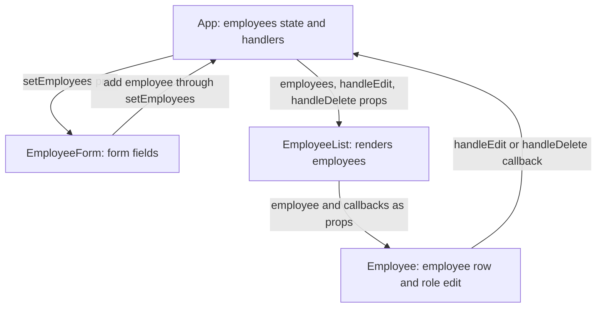

# Information Flow

This React application demonstrates one-way data flow and inverse data flow with a small employee management interface. Users can add employees, update an employee's role, and remove employees.

## How State Flows

`App` owns the shared `employees` array, making it the single source of truth for the employee list. It passes the array and change handlers down to `EmployeeList`, which passes each employee and those handlers to an `Employee` row. `EmployeeForm` receives the `setEmployees` state setter to add a new employee.



### Add an Employee

1. `EmployeeForm` keeps the first name, last name, and role in local form state.
2. On submit, it creates an employee with a unique ID and calls `setEmployees`.
3. `App` appends the new employee to the existing array using a functional state update.
4. React renders the updated employee list.

### Edit or Remove an Employee

- Each `Employee` row keeps its edit mode and draft role locally. Submitting the edit calls `handleEdit` with the updated employee.
- `App` handles edits by replacing the matching employee in its state array. It handles removals by filtering that employee out.
- The updated `employees` array flows down to `EmployeeList` and its rows, so the rendered table reflects the latest state.

## State Management Notes

- State is stored in the highest relevant shared component (`App`), ensuring a single source of truth for employees.
- Props pass state down so child components receive the latest data whenever the parent renders.
- Child components use inverse data flow: they notify the parent of changes through callback functions instead of directly changing the parent's state.
- When `employees` changes, React re-renders the relevant component tree and updates the UI to reflect the latest data.
- This approach is essential when multiple components need shared state and changes must stay consistent across the interface.
- Keeping state in the right place improves maintainability and makes features such as search and filters easier to add. It can also help keep updates appropriately scoped; avoiding unnecessary re-renders may require additional optimization as the application grows.
- This pattern is a foundation for more advanced state management, including Context API and Redux, when an application's needs grow.

## Run Locally

```bash
npm install
npm run dev
```

To create a production build or run ESLint:

```bash
npm run build
npm run lint
```
